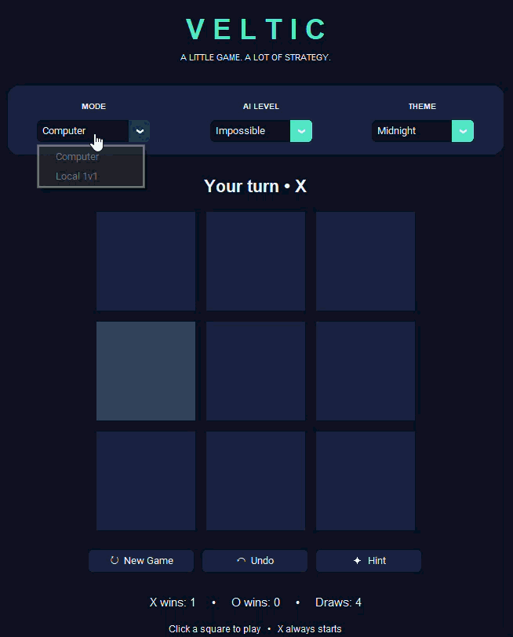

<div align="center">

# VELTIC

**A little game. A lot of strategy.**

An offline Tic-Tac-Toe desktop application built with **Python** and **CustomTkinter**.
Play against a computer with adjustable difficulty or challenge a friend on the same computer.

**Developed by Mujtaba Ali Misri**

</div>

## Gameplay preview



## Features

- **Play against the computer:** Easy, Medium, Hard, or Impossible difficulty. Impossible uses minimax to select moves.
- **Local two-player mode:** Play X vs. O with a friend on the same PC.
- **Five themes:** Midnight, Neon, Ocean, Sunset, and Light.
- **Interactive feedback:** Hover highlighting and a highlighted line for winning combinations.
- **Game controls:** Start a new game, undo moves, or request a hint.
- **Statistics:** Tracks X wins, O wins, and draws.
- **Saved preferences:** Remembers your theme, selected mode, difficulty, and scores locally.
- **Fully offline:** No account, paid service, API key, or internet connection required during play.

## Play the game

### Option A — Download the Windows executable

Visit this repository's **Releases** page and download `Veltic.exe` from the latest release **once a release is published**. Double-click it to start playing; Python is not required.

### Option B — Run from source

You will need Python 3 and pip installed.

```powershell
py -m pip install -r requirements.txt
py main.py
```

## Build a Windows executable

```powershell
py -m pip install pyinstaller
py -m PyInstaller --noconfirm --onefile --windowed --collect-all customtkinter --name Veltic main.py
```

The generated executable will be located at `dist/Veltic.exe`. Build artifacts are excluded from Git by `.gitignore`; distribute the executable through **GitHub Releases** instead.

## How to play

Players alternate placing X and O in the nine squares. The first player to place three marks in a row, column, or diagonal wins. If all squares fill without a winner, the game is a draw. **X moves first.**

## Keyboard shortcuts

| Shortcut | Action |
| --- | --- |
| `Ctrl + N` | Start a new game |
| `Ctrl + Z` | Undo the previous move |

## Tech stack

- **Python** — game logic, computer opponent, and local settings
- **CustomTkinter / Tkinter** — desktop user interface
- **PyInstaller** — optional Windows executable packaging

## Project structure

```text
veltic/
├── main.py            # Game UI, logic, AI, and local persistence
├── assets/
│   └── veltic-demo.gif # Add your own gameplay recording here
├── requirements.txt   # Python dependency
├── .gitignore
├── LICENSE
└── README.md
```

## License

Licensed under the **MIT License**. See [LICENSE](LICENSE) for the full license text.

Copyright © 2026 Mujtaba Ali Misri.
